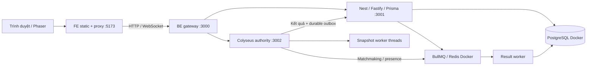

# Kiến trúc V2 — hai dự án độc lập

`be/` và `fe/` có package, lockfile, node_modules, scripts, tests và build riêng. Không dùng workspace, shared folder, symlink hoặc import xuyên dự án. Có thể sao chép riêng từng thư mục để cài đặt/build. Mã engine/codec cần thiết được sở hữu và phát hành riêng ở `be/game` và `fe/public/game`; browser test xác nhận hai bản protocol giao tiếp được.

FE production còn render HTML SEO từ `GET /api/site` version 1, cache 60 giây; nội dung/metadata/domain nằm trong PostgreSQL `system_settings.site`. Guides không tải gameplay bundle. FE phục vụ Brotli/gzip và ETag cho static/HTML; proxy API/tài khoản giữ nguyên semantics upstream. Xem [SEO](SEO.md).

## Quyền và dữ liệu

PostgreSQL là nguồn quyền, whitelist, policy, caps và catalog. Redis chỉ phục vụ cache, queue, matchmaking/presence. Seed có migration marker và không khôi phục mặc định khi restart. Room tải một catalog có version khi tạo; tick chỉ dùng bản chụp trong RAM. Catalog cũ được giữ để giải mã, ghi thưởng và replay báo cáo đúng version.

Tài khoản migration chuẩn bị schema/privileges. API và result worker có credential PostgreSQL riêng; authority không được truyền credential DB. Mutations quản trị dùng permission/whitelist/MFA/reason/audit/idempotency. Kiểm tra quyền lại trong transaction sau advisory lock; sửa quyền thu hồi phiên đặc quyền và cache. Room kiểm tra lại admission định kỳ theo catalog. DENY thắng ALLOW.

Kết quả từ authority được ghi outbox trước, gửi API nội bộ, xếp BullMQ rồi transaction SQL khóa tài khoản. Life ID và payload hash bảo đảm retry không cộng thưởng hai lần, kể cả sau restart Redis worker. Public client không gửi kết quả cuối trận. Solo/khách/bot không được nhận phần thưởng tài khoản.

## Mô phỏng và truyền mạng

Authority tích lũy thời gian bằng monotonic clock, chạy tick cố định theo catalog (20 Hz mặc định). Broad phase dùng spatial grid; AI utility theo chu kỳ riêng. Director, weather và objectives có nhịp chậm hơn combat. Mỗi phòng có snapshot worker threads xử lý AOI, path delta và đóng gói binary. Batch đang chờ được gộp; epoch/timestamp chống dùng baseline cũ sau reconnect. Kết nối có hàng đợi gửi quá giới hạn được ngắt để reconnect/resync.

Snapshot gần/trung bình/xa mặc định 15/5/1 Hz. Frontend dự đoán đầu của chính mình, phát lại input chưa ACK, làm mượt hiệu chỉnh và nội suy người khác. Body dựng từ đường đi và metadata đốt/nhánh. Phaser dùng pool sprite, các mức graphics và Auto giảm/tăng chất lượng theo FPS ổn định; độ phân giải và ngưỡng Auto lấy từ catalog DB.

## Vận hành

HTTP log có X-Request-ID xuyên FE/gateway/API, file JSONL giới hạn dung lượng riêng mỗi dự án. Log room/outbox nằm ngoài tick. Gateway có live/readiness version 1; proxy có deadline và hủy upstream khi client ngắt. API có metrics HTTP, authority có metrics outbox. Xem [OPERATIONS](OPERATIONS.md).

Frontend chỉ phục vụ nội dung `dist/`, proxy `/api/`, `/admin/`, `/rt/`. Backend không đọc hoặc phục vụ mã frontend. API nội bộ, metrics, `.env` và `.data` không được proxy ra frontend. Docker Compose và monitoring thuộc backend; tên project/volume được giữ nguyên sau di chuyển.

`serpent_room_total_tick_seconds` đo AI, simulation và gửi việc cho worker; `serpent_snapshot_seconds` đo AOI/encode trong worker. Không cộng nhầm hai số này thành một tick đồng bộ. Prometheus/Grafana phục vụ giám sát cục bộ. Trace collector hiện xuất log, chưa có storage trace lâu dài.

Giới hạn đã đo và phần còn cần kiểm chứng nằm trong V2-IMPLEMENTATION.md. Không suy rộng thử tải một phòng trên máy local thành cam kết 200–300 CCU hoặc FPS trên điện thoại.
