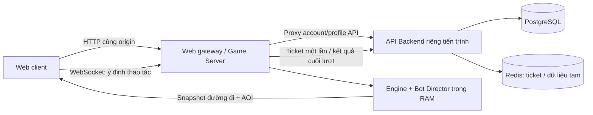

# Thiết kế theo update.md — 183–222

> Tài liệu lịch sử của bản 0.2. Kiến trúc, tần số và đường dẫn hiện tại xem [ARCHITECTURE.md](ARCHITECTURE.md), [CONTRACT.md](CONTRACT.md) và [V2-IMPLEMENTATION.md](V2-IMPLEMENTATION.md). Các giới hạn/chỗ chưa có trong tài liệu này không phải trạng thái V2 hiện tại.

Nguồn: toàn bộ 1.329 dòng `update.md`, bổ sung cho `instruction.md`. Mục 222 bị cắt tại câu `The hidden attribute activa`; các quyết định bổ sung dưới đây được ghi là quyết định triển khai, không coi là phần còn thiếu của tài liệu gốc.

## Ranh giới hệ thống

- Backend quản lý ID tài khoản, phiên đăng nhập, ví, mở khóa, mastery, nâng cấp lâu dài, thành tựu, lịch sử, season và bảng xếp hạng. Không tính frame chiến đấu.
- Game Server quản lý vị trí, HP, EXP, tăng trưởng, kỹ năng, RNG nâng cấp, bot và điểm trực tiếp. Không chấp nhận vị trí/điểm/thưởng do client khai báo.
- Theo yêu cầu triển khai: PostgreSQL và Redis chạy bằng Docker Compose, có volume riêng; backend kết nối bằng `DATABASE_URL` và `REDIS_URL`. Không dùng PostgreSQL nhúng hoặc kho ticket giả lập cho runtime. Dữ liệu tài khoản không mất khi khởi động lại container.
- Cookie phiên HttpOnly, SameSite; mật khẩu băm scrypt với salt riêng; token phiên chỉ lưu bản hash. Request thay đổi dữ liệu kiểm tra origin. Ticket ngắn hạn chỉ dùng một lần và gắn với ID tài khoản.
- Client Solo cục bộ không được cộng tiền/xếp hạng server. Khách vẫn được thử game; cần tài khoản để lưu tiến trình Arena.

## Danh tính và đơn vị lưu kết quả

`accountId` tồn tại lâu dài. `playerId` là thực thể trong phòng. `lifeId` duy nhất cho mỗi lần spawn; hồi sinh tạo lifeId mới. `arenaId` là thế giới chạy liên tục. Co-op vẫn có match ID cho trận hữu hạn.

Open Arena không chờ world kết thúc: mỗi life đã chết hoặc chủ động rời là một kết quả cuối lượt. Ghi version game/balance/upgrade pool cùng kết quả. Bot mang cờ server tạo và không có account ID, ví, thành tựu hoặc xếp hạng mùa.

Kết quả chỉ đi qua API nội bộ có credential server. Backend xác nhận ticket/account, content version, giới hạn số liệu và khóa idempotency. Trong một transaction: ghi match/result/build → ledger và wallet → mastery/statistics/achievements → season leaderboard. Retry cùng life ID không được cộng thưởng lần hai. Cùng ID nhưng payload khác phải báo conflict để điều tra. Không ghi vị trí theo tick.

## Open Arena

- Là lựa chọn chơi chính: vào thế giới đang chạy ngay, không có Ready. Solo và Co-op hữu hạn vẫn có tab riêng.
- World tiếp tục khi người chơi chết/rời. Chu kỳ boss/event độc lập với tuổi đời người chơi; điểm sống sót tính từ lần spawn, không lấy uptime world.
- Chết → kết quả riêng → đợi 4 giây → yêu cầu hồi sinh. Server xác nhận thời gian, tạo thân gốc, cấp 1, kỹ năng/loài gốc và xóa build của life trước. Tài khoản/tiến trình vẫn giữ.
- Spawn lấy 40 ứng viên, ưu tiên xa đầu/thân rắn lớn, boss và quái; có 3 giây bảo vệ. Tấn công PvP hủy bảo vệ ngay. Chưa duy trì lịch sử vùng spawn gần đây.
- PvP dùng sức chịu đựng theo đốt của game hiện có, không tự đổi thành luật chết tức thì khi đầu chạm thân. Có chống ghi kill trùng và giảm điểm khi farm lại cùng đối thủ.
- Loot chết dùng 28% giá trị tăng trưởng thu được trong life, có trần số orb. Không biến toàn bộ vàng tài khoản hay đốt miễn phí khởi đầu thành phần thưởng farm vô hạn.
- Nâng cấp online có 5 giây; thao tác điều hướng/kỹ năng vẫn hoạt động. Solo tiếp tục tạm dừng.
- Bảng điểm trực tiếp hiển thị rank/tên/điểm/độ dài/PvP kills, bot được đánh dấu rõ. Điểm gồm sinh trưởng, PvE, PvP, boss và sống sót; tham số được version hóa.

## Dân số và bot

Target thiết kế: max 30, soft 24, max bot 18. Công thức `min(18, max(0,24-humans))` cho 0 người là 18 bot, không đạt minimum 20 trong mục 193; đây là mâu thuẫn trong tài liệu. Chọn giữ trần 18 bot, không tự tăng bot lên 20. Với 2 người trở lên sẽ đạt tối thiểu 20 nếu còn chỗ.

Giới hạn thử nghiệm ban đầu tiếp tục dựa trên capacity đã đo: default 10 cho Arena, bot mục tiêu được thu nhỏ theo capacity. Cấu hình target 30 phải qua bài đo mật độ cuối game trước khi công bố khả năng phục vụ 30 người.

Bot Director chạy quyết định 5–10 Hz; reaction thực theo cấp 0,4 / 0,24 / 0,15 giây. Chỉ nhận thực thể trong bán kính nhận thức, không đọc input client. Có Farmer, Hunter, Survivor, Aggressor, Objective; dùng cùng API input và chọn nâng cấp hợp lệ, không cấp chỉ số hoặc đồ miễn phí.

Bot rời khi người thật đến: ưu tiên bot xa người thật, đánh dấu RETIRING rồi despawn với hiệu ứng; bot không chiếm quota người thật. Nếu đã chạm hard cap, thay bot bằng người ngay trong admission. Hành vi tự đi ra biên chưa có. Redis reservation cần atomic khi mở rộng nhiều gateway.

## Đồng bộ đường đi và tần số

Open Arena dùng simulation 20 Hz, snapshot 10 Hz; Co-op cũ giữ 30/15 để không đổi ngầm baseline đã đo. Render dùng requestAnimationFrame và làm mượt; mục tiêu 60 FPS phải đo trên thiết bị thực.

Protocol mới giữ version riêng với protocol 1/2. Truyền đầu, hướng, tốc độ, body path và trạng thái quan trọng của đốt (ID, type, HP); client dựng tọa độ đốt cách nhau 18 đơn vị dọc đường đi. Đường đi full khi mới xuất hiện/reset/resync, sau đó chỉ append các điểm mới và trim lịch sử; không gửi XY của từng đốt theo tick. Baseline theo kết nối, số thứ tự và ACK input; full định kỳ để phục hồi.

AOI giữ chỉ số chung cho leaderboard nhưng chỉ truyền đường đi/chi tiết thực thể trong vùng quan sát. Giữ thân chính mình đầy đủ. Dead/spectator theo mục tiêu camera. Spatial grid hiện dùng cho PvP/bot; spawn và AOI vẫn duyệt tập thực thể có giới hạn.

## Độ hiếm, tags và cộng hưởng

Mỗi lựa chọn gồm ID nội dung và rarity do RNG server quyết định. Client chỉ chọn ID được cung cấp, không gửi rarity để server tin theo. Giữ lịch sử upgrade roll trong final build.

| Giai đoạn theo tuổi life | Common | Rare | Epic | Legendary | Mythic |
| --- | ---: | ---: | ---: | ---: | ---: |
| <180 giây | 70 | 24 | 5 | 1 | 0 |
| 180–420 giây | 55 | 30 | 12 | 2,8 | 0,2 |
| ≥420 giây | 40 | 32 | 20 | 7 | 1 |

Luck nhân trọng số theo tier rồi chuẩn hóa; không cộng thẳng vào xác suất Mythic. Tags chuẩn hóa (FIRE, POISON, BODY, DAMAGE, DEFENSE, GROWTH, CRITICAL, EXPLOSION…). Resolver chạy sau nâng cấp/thêm/mất/đổi đốt, không cần quét mỗi frame khi build không đổi.

Năm nhóm luật: nguyên tố, cơ chế, kề đốt, ngưỡng số lượng và độ hiếm. `Toxic Ignition`: mục tiêu đồng thời cháy và nhiễm độc phát nổ khi chết. Hàng đợi proc có trần để không tạo recursion vô hạn. Higher rarity mở hiệu ứng hành vi (lan cháy, nổ, xung theo tick), ngoài hệ số chỉ số.

LOCKED không hiện; HINTED hiện tiến độ gợi ý; ACTIVE hiện tên/tác dụng. Quyết định cho phần file bị thiếu: DISCOVERED là ghi nhớ đã khám phá trong hồ sơ; trait chỉ có hiệu lực khi điều kiện build hiện tại còn đúng. Mất đốt có thể mất ACTIVE nhưng không mất lịch sử khám phá.

## Giao diện

- Trang chính: Open Arena nổi bật, nút Vào đấu trường, số người thật/bot; tabs Solo/Co-op; tài khoản và ví; hồ sơ/lịch sử/mùa giải.
- HUD: điểm/độ dài/PvP kill, bảng top có [BOT], thông báo bảo vệ spawn, traits active/gợi ý.
- Thẻ nâng cấp: tên/tags/mô tả, nhãn và màu rarity, 5 giây online; không khóa chuột/di chuyển.
- Kết quả Arena: life vừa kết thúc, trạng thái đã lưu/đang lưu/khách, đếm ngược hồi sinh, nút hồi sinh/rời. Mở lại hoặc reload không cộng thưởng lần hai.
- Hồ sơ: ví, mastery, unlocks, meta upgrades, thành tựu, bản build cuối mỗi life và leaderboard chỉ người thật.

## Kiểm chứng và triển khai

1. Tests engine: vòng đời Arena không dừng, loot 28%, spawn/protection, respawn reset, rarity có seed, proc/cộng hưởng và bot đúng luật.
2. Tests network: join không Ready, late join, bot nhường chỗ, reconnect/death/respawn, path reconstruction và full recovery.
3. Tests backend dùng PostgreSQL engine: đăng ký/đăng nhập, persistence sau reopen, ticket một lần, duplicate/conflicting results, rollback, bot exclusion, mùa/version/build.
4. Browser: thao tác Arena + auth + upgrades + profile + respawn; hồi quy Solo/Co-op và mobile.
5. Load test riêng 10/20/30 với thân dài, AI và PvP; so sánh payload protocol đường đi. Không suy ra 30 người chỉ từ việc chỉnh hằng số.

## Đối chiếu bản chạy 0.2

| Mục update | Bản đã triển khai | Phần chưa mở rộng |
| --- | --- | --- |
| 183–191 | Backend riêng, Docker PostgreSQL/Redis, account/auth/wallet/unlocks/mastery/meta/achievements/history/season leaderboard/version, transaction + outbox | Mùa hiện có một lịch cố định; cosmetics/EP/evolution mới có schema; chưa có điều phối nhiều server |
| 192–200 | Arena vào ngay, world liên tục, spawn bảo vệ, PvPvE, loot 28%, respawn 4 giây, bảng điểm bot, chọn nâng cấp 5 giây | Capacity hiện 10; chưa có lịch sử vùng spawn; chưa chứng minh 30 người |
| 201–204 | Authority server, 20/10 Hz Arena, protocol 3 body path + AOI + resync/ACK | Prediction/reconciliation và buffer nội suy timestamp chưa có |
| 205–213 | Bot Director, 5 tính cách, reaction theo cấp, nhận thức giới hạn, dùng cùng luật, ưu tiên người, loại bot khỏi persistent ranking | Population thu nhỏ theo cap 10; retirement tức thì có hiệu ứng; chưa có mọi state/hành vi của quy mô 30 |
| 214–221 | 5 rarity, trọng số theo tuổi life, May mắn, tags, 5 nhóm cộng hưởng, proc Hỏa độc và lửa bậc cao | Các nâng cấp ngoài lửa chủ yếu dùng hệ số; chưa phải toàn bộ catalog nội dung tương lai |
| 222 | LOCKED/HINTED/ACTIVE theo build, nhớ khám phá trong life/profile | File nguồn bị cắt tại ACTIVE; DISCOVERED dùng quyết định ghi nhớ đã nêu ở trên |

Kết quả kiểm thử và phép đo thực ở [VALIDATION.md](VALIDATION.md). Không coi các cột chưa mở rộng là tính năng đã hoàn thành.

## Nguồn kỹ thuật

- [PostgreSQL constraints](https://www.postgresql.org/docs/current/ddl-constraints.html) và [INSERT/ON CONFLICT](https://www.postgresql.org/docs/current/sql-insert.html).
- [node-postgres transaction dùng cùng connection](https://node-postgres.com/features/transactions).
- [Redis GETDEL cho ticket dùng một lần](https://redis.io/docs/latest/commands/getdel/).
